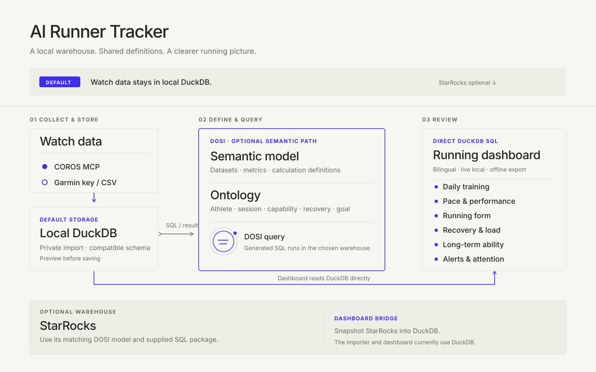
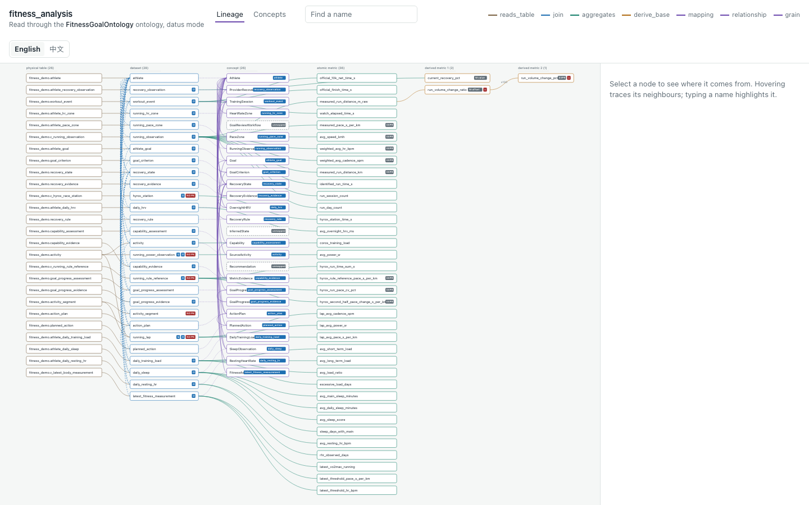
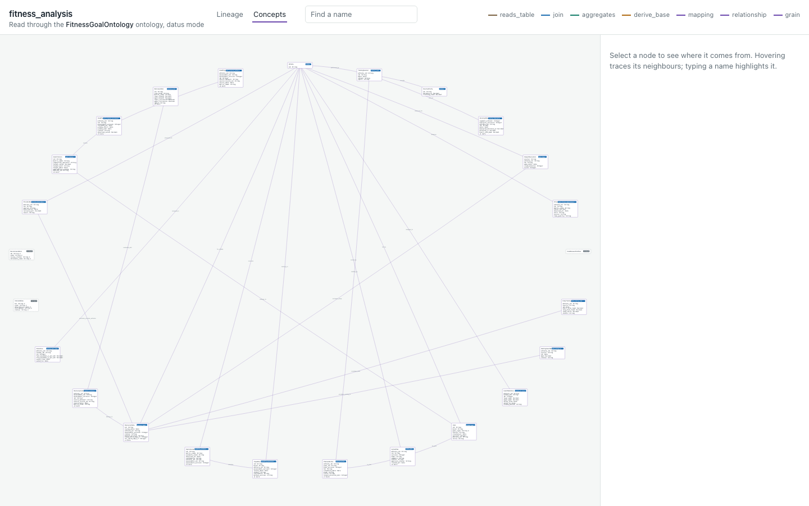

# AI Runner Tracker architecture

AI Runner Tracker stores running data in **local DuckDB by default**. The dashboard and importer use DuckDB without requiring StarRocks or DOSI. A separate, optional DOSI path examines metric definitions and ontology mappings. StarRocks can serve as an alternate warehouse for model queries. The coaching knowledge guides a person or Agent; it is not an automatically running rule engine.

The editable SVG uses the approved Datus VI palette, Inter-first sans-serif typography, flat line work, and a circular context motif. It shows the implemented paths without implying that DOSI executes coaching rules.

The watch inputs are shown together because COROS and Garmin are two ways to provide a runner's data. Fictional fixtures and the owner-authorized snapshot are onboarding data choices, described in the README rather than separate architecture components.

## How the dashboard relates to DOSI

The dashboard is a local, offline view built with direct SQL over DuckDB. **It does not call DOSI or traverse the ontology when a visitor opens a chart or alert.** Its calculations follow the same modeled distinctions as the DOSI examples: a real workout versus duplicate source activities, measured versus reference distance, official versus watch race time, and missing observations versus zero. This makes the dashboard useful without an engine running in the background, while the DOSI route offers inspectable definitions and generated SQL for model-backed metrics and three derived observation subtypes. The current project does not automatically reconcile every dashboard calculation with DOSI on each build.

The ontology contributes the meaning and evidence path behind broader questions. For example, an Agent reviewing an alert about recovery can trace `RecoveryState` to training load, sleep, HRV, resting heart rate, and provider recovery observations. The alert page implements its own review checks from the available data; the ontology and [coaching rule catalog](fitness_ontology.yaml) explain what to inspect and how to describe it. DOSI does not execute those coaching rules or change a training plan automatically.

## Semantic model and ontology in this project

The [DuckDB semantic model](fitness_analysis.yaml) defines source-backed datasets, joins, and metrics for running performance, training volume, load, recovery, and goals. The [StarRocks version](fitness_analysis.starrocks.yaml) targets the supplied StarRocks package. In the lineage view below, source tables lead to datasets and then to atomic and derived metrics. As one concrete path, `v_running_observation` feeds `running_observation`, which defines `measured_run_distance_km`; DOSI generates SQL for the selected database to execute. Open the [interactive lineage view](lineage.html) to inspect individual nodes.

The [ontology](subject/ontology/fitness.ontology.yaml) defines concepts such as Athlete, TrainingSession, RunningObservation, Capability, RecoveryState, Goal, and evidence records. The [standalone mapping](subject/ontology/fitness.mapping.yaml) binds queryable concepts to the [DuckDB semantic model](subject/semantic_models/duckdb/fitness_analysis.yaml); the StarRocks project has its own matching files. Some arrows are conceptual or describe an Agent workflow rather than an executable join; [the binding audit](ontology_bindings.yaml) identifies which mappings are backed by data. The image shows the Concepts tab of the project's [interactive ontology view](dosi-ontology-view.html); open the HTML to zoom and inspect each mapping. Configurable alert conditions live in the ontology's `ai_context.x_coaching_knowledge` field, which is valid in the Apache Ossie 0.2 ontology schema but is not an executable Ossie rule.

## Storage choice

**Default: DuckDB.** The fictional fixture, confirmed watch imports, and the optional owner snapshot live in separate local database files with a compatible `fitness_demo` schema. The dashboard builder reads one or more DuckDB files and writes an offline HTML snapshot. It does not call DOSI.

**Optional: StarRocks.** The repository includes schema/seed SQL and a matching DOSI model/ontology pair for queries against a separately configured StarRocks server. Current watch imports write to local DuckDB; the dashboard does not query StarRocks directly. To show StarRocks data in the dashboard, first use `dashboard/sync_starrocks.py` to make a local DuckDB snapshot, then build the dashboard from that snapshot. This is a bridge, not an automatic live sync.

## What the dashboard reviews

| View | Questions it helps explore |
| --- | --- |
| Daily training | How often and how much did this athlete run, and how has the recent training pattern changed? |
| Pace and performance | How do measured pace and other available run outcomes change over time? |
| Running form | What do available gait measurements, such as cadence, show across comparable runs? |
| Recovery and load | What do provider training load, sleep, resting heart rate, HRV, and recovery observations show when available? |
| Long-term ability | How do dated fitness estimates and personal zone settings develop over a longer period? |
| Alerts and attention | Which review rules have supporting evidence, and which cannot be evaluated because data is missing? These are prompts for review, not diagnoses or automatic plan changes. |

## Component map

| Part | Main files | What it does today |
| --- | --- | --- |
| Default fictional warehouse | `warehouse/build.py`, `warehouse/duckdb_*.sql` | Generates reproducible sample rows and a local DuckDB database. |
| Watch importer | `coros_import/` | Runs locally; previews COROS MCP or Garmin key/CSV data before writing to an ignored private DuckDB database. |
| Owner snapshot | `personal_duckdb/`, `personal_starrocks/` | Supplies an optional, identifiable real-data example under a separate data license. |
| Dashboard | `dashboard/build.py`, `dashboard/index.html`, `dashboard/personal-preview.html` | Reads DuckDB directly and writes static English/Chinese HTML with an athlete selector. It does not call DOSI. |
| Semantic model | `subject/semantic_models/duckdb/fitness_analysis.yaml`, `starrocks_project/subject/semantic_models/starrocks/fitness_analysis.yaml` | Defines datasets, relationships, and metrics for DuckDB or StarRocks. DOSI turns selected metric queries into SQL. |
| Ontology and mapping | `subject/ontology/fitness.ontology.yaml`, `subject/ontology/fitness.mapping.yaml`, `starrocks_project/subject/ontology/`, `ontology_bindings.yaml` | Defines concepts separately from their dataset and field bindings for DOSI 0.2.2. |
| Coaching guidance | `fitness_ontology.yaml`, `RECOVERY_RULES.md`, `TRAINING_COACH_AGENT.md` | Documents thresholds, evidence checks, and human-reviewed actions. No background coaching service or DOSI rule executor is included. |
| Optional StarRocks route | `warehouse/starrocks_*.sql`, `fitness_analysis.starrocks.yaml`, `fitness_ontology.starrocks.yaml`, `dashboard/sync_starrocks.py` | Loads and queries a separately configured StarRocks warehouse; the dashboard uses a local DuckDB snapshot when showing its data. |

## Follow one question

For “How much did I run?”, the dashboard can display a total calculated with its direct DuckDB query. On the optional model-backed route, DOSI reads the `measured_run_distance_km` metric, generates SQL, and the selected database executes it. The ontology provides related concepts and evidence paths for broader questions such as “Is my training increasing too quickly?” The rule catalog guides interpretation, and the athlete reviews any proposed plan adjustment.

Start with [README Quickstart](README.md#quickstart), then choose [watch import](coros_import/README.md) or [DOSI exploration](README.md#explore-dosis-semantic-model-and-ontology). Give [agent.md](agent.md) to an assistant helping an end user. [AGENTS.md](AGENTS.md) covers repository development.
