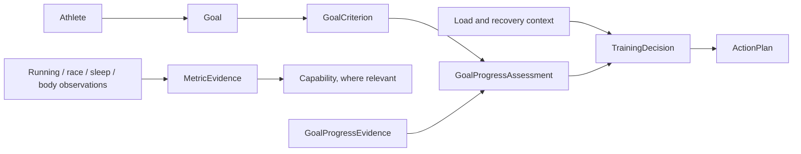

# Reusable fitness goals, capability evidence, and progress assessment

**Status:** general ontology, versioned goals and action plans, version-scoped goal criteria, dated capability reviews, criterion-specific goal-progress reviews, and individual planned actions are implemented in the fictional DuckDB/StarRocks demo. Real provider plan import, verified execution matching and other optional tables below remain proposals. Existing metric formulas are unchanged. No personal measurements or goals are included.

## Purpose

This ontology serves runners with different goals: a 10K, half marathon or marathon; more consistent running; better sleep; or body-composition change. A person may have several goals at once. A race is one goal type, not the parent of every other goal.

`Capability` is an ability direction supported by evidence, not a universal score. A COROS Running Fitness score, if available, is a dated provider estimate; it is not a percentage of progress toward a user's goal. `RecoveryState` informs a near-term training decision, not the goal-gap calculation.

In the current public semantic model, `Capability` is stored as a dated review with `MetricEvidence` rows citing `FitnessAssessment` (VO2max and threshold estimates), `RunningObservation` (pace, heart rate and cadence), `TrainingSession` (official race outcomes), or a versioned `PaceZone` boundary. `SourceActivity` power may be added when comparable evidence exists. `HeartRateZone` is an athlete profile; repeated, comparable `PaceZone` versions can support a running-capability trend, but one version is only a baseline. `DailyTrainingLoad`, `SleepObservation`, `RestingHeartRate` and `ProviderRecoveryEstimate` inform recovery or training decisions. COROS's separate Running Fitness breakdown scores are **not yet imported**. The existing `fitness_measurement` table can represent source-specific metric codes, but historical score analysis would require a non-latest dataset and a verified importer field.

Persisting a `Goal` is a product choice, not a requirement for the ontology class to exist. A temporary goal in an Agent conversation can support a one-off explanation if its criteria are supplied in the prompt. The implemented `athlete_goal` table stores athlete-scoped, versioned goals, enabling consistent queries across sessions and an audit trail when the goal changes. The `goal_criterion` table stores a target for each goal version; `goal_progress_assessment` saves each dated review and the method used, while `goal_progress_evidence` records the cited observations.

`ActionPlan` is a versioned plan direction tied to one version of a goal. Its status, approval state, timestamps and revision reason are stored separately from any individual workout or sleep action. The fictional two-day running plan was human-approved; a revised three-day plan is a draft awaiting human approval. A saved plan is not evidence that the athlete followed it.

`PlannedAction` stores proposed or approved runs, rest days and sleep routines under an exact plan version. The fictional old plan includes one run manually verified against a completed event and one candidate matched only by date and sport. The candidate remains `candidate_only`; it has no `fulfilled_by` relationship. Draft-plan actions remain proposed and unassessed. These are hand-built fictional records, not a live COROS plan import.

## Ontology path

`GoalCriterion` specifies one target or milestone, unit, comparison direction and time window. A goal can have multiple criteria. `GoalProgressAssessment` evaluates **one criterion** with dated, cited evidence and can report `achieved`, `on_track`, `needs_review`, or `insufficient_evidence`. There is no cross-goal readiness percentage.

| Goal | Criterion example | Existing evidence | Limit |
| --- | --- | --- | --- |
| 10K / half / full marathon | Complete the distance, optionally within a target time | Running distance and official race result | Compare times only at the same distance and clock basis; predictions are labelled |
| Run regularly | At least N standalone run days per week | `run_day_count`, `run_session_count` | Requires an explicit week boundary and target N |
| Improve sleep | Main sleep duration over a defined period | `avg_main_sleep_minutes`, `avg_sleep_score` | Align to wake date; score is provider-specific |
| Reduce body fat | Body-fat percentage trend toward a target | No body-composition table yet | `insufficient_evidence` until dated measurements are available |

Training load may inform a plan or recovery review. It cannot substitute for body-fat measurements or prove that another goal has been met. Heart-rate and pace-zone boundaries are training context, not goal completion evidence by themselves.

## COROS plan and completed activity mapping

The connected COROS MCP can read a plan-library template, its day-by-day workouts, dated scheduled workouts, their detailed sections and scheduled status, plus actual activity records and activity detail. A library plan that has not started has relative day numbers rather than calendar dates. Dated standalone workouts may exist without an active plan.

Map a COROS plan template or active execution to `ActionPlan`, a scheduled session to `PlannedAction`, and a recorded workout to `TrainingSession`/`SourceActivity`. Preserve source ID, source role (template versus active execution), date, status and fetched-at time. An external plan ID must never be confused with a workout ID.

The current connector outputs a scheduled-workout identifier scoped to its date and a separate activity identifier for the recorded workout. The inspected actual-activity response did **not** expose a shared schedule/plan identifier. Therefore a date/title/sport match is only a *candidate*, even when COROS labels the schedule item completed. The fictional `planned_action` table separates `candidate_event_id` from `verified_event_id`, and records `match_method` and `completion_status`; only the verified ID maps to `fulfilled_by`. For real provider imports, preserve the match-review history and source evidence in a separate execution-link table; do not silently claim that a planned duration equals actual duration.

Suggested additional tables when plan ingestion is implemented: `external_action_plan` (source, external plan ID, template/execution role, status, version); `external_planned_action` (source, scheduled date, schedule ID, optional plan ID, workout structure, status); and `planned_action_execution` (scheduled-action key, activity key, match method, review status). The `ActionPlan` and `PlannedAction` concepts remain generic enough for other providers and for non-running actions.

## Proposed warehouse additions

All tables are athlete-scoped. Add equivalent DuckDB and StarRocks definitions and synthetic fixtures when implementing this proposal.

| Table | Grain and essential fields | Role |
| --- | --- | --- |
| `athlete_goal` (implemented) | Athlete × goal ID × version; `goal_type`, `title`, `status`, `created_at_utc` | Preserve multiple goals and their revisions |
| `action_plan` (implemented) | Athlete × plan ID × version, referencing one goal version; title, summary, status, approval state, timestamps and revision reason | Preserve plan drafts, approvals and revisions without implying execution |
| `planned_action` (implemented) | Athlete × plan ID × version × action ID; date, action kind, proposal/approval state, completion-review state, separate candidate and verified event IDs | Represent running, rest and sleep arrangements without treating a candidate match as completion |
| `goal_criterion` (implemented) | Athlete × goal ID × version × criterion ID; `criterion_kind`, nullable `metric_name`, `comparison_operator`, nullable `target_value`, `target_unit`, `aggregation_window`, nullable `target_date`, `evidence_policy`, `created_at_utc` | Represent race, consistency, sleep or body-composition targets without race-only columns |
| `provider_capability_observation` | Athlete × source × ability × observation time; `ability_code`, nullable `score_value`, `score_scale`, `source_snapshot_id` | Store provider Running Fitness breakdown only if actually imported |
| `provider_race_prediction` | Athlete × source × race distance × observation time; `distance_m`, `predicted_finish_s`, `source_snapshot_id` | Separate prediction from an official race result |
| `body_measurement` | Athlete × measurement event × metric code; `metric_code`, `metric_value`, `unit`, `measured_at_utc`, `source`, `quality_status` | Enable body-composition goals with consented observations |
| `goal_progress_assessment` (implemented) | Athlete × assessment ID × review version, joined to a particular goal/criterion version; review date, window, `status`, nullable `observed_value` and `difference_value`, `comparison_basis`, `method_version` | Store a reviewable, criterion-specific conclusion |
| `goal_progress_evidence` (implemented) | Assessment × cited input; `source_dataset`, `source_record_id`, `source_date`, nullable `metric_name`, value, unit and `quality_status` | Trace every conclusion to source data |

The current warehouse stores fictional versioned goals, four action-plan versions and criteria for 10K time, weekly run days, and sleep duration, plus six dated capability reviews and four criterion-specific goal-progress reviews. The older running goal asks for two days in the completed April 6–12 week and has two distinct run days (`achieved`, gap 0). Version 2 asks for three days in April 13–19 and has two (`needs_review`, observed-minus-target gap −1 day). The sleep review cites three wake-day observations but withholds the seven-day average because its policy requires five valid days. The 10K review for `demo_02` has no same-athlete official result; `demo_01`'s 3,190-second race does not qualify. Both are `insufficient_evidence` with null observed values and gaps. It does not yet store provider ability scores or body measurements. Never synthesize a provider score, race prediction or body-fat value from unrelated metrics.

## Assessment rules

1. Match goal criterion, semantic metric and observation by athlete, unit, distance when relevant, time window and source. Keep official race time separate from watch elapsed time and from predictions.
2. Calculate a numeric difference only for comparable values. Interpret its sign using the criterion's operator: lower race time is better, while more running days or sleep minutes may satisfy a lower bound.
3. For a finish-only goal, use milestones, not invented seconds or a percent. For a body-fat goal without measurements, return `insufficient_evidence`.
4. Consider device load, device recovery, sleep and resting heart rate when suggesting the **next training action**. They do not create a universal capability score or override the criterion-specific result.
5. Record method version and cited evidence. A person approves changes to an action plan.

## Implementation order

1. Versioned goals, concurrent-goal fixtures, versioned criteria, and their relationship to stored goals are complete.
2. Criterion-specific reviews using current running, race and sleep evidence are complete in the fictional fixture. Evaluate future reviews with the same declared time window and source-quality gates.
3. Add body measurements only with an explicit, consented source. Import provider scores or race predictions only when the connector returns those fields.
4. The synthetic `PlannedAction` mapping is complete. Add provider schedule IDs, source snapshots and a versioned execution-match audit before importing real COROS plans. Validate future examples for half-marathon completion and body-composition goals with missing data.

## Sources

- [COROS: Understanding Your Running Fitness Score](https://support.coros.com/hc/en-us/articles/25464626934164-Understanding-Your-Running-Fitness-Score)
- [COROS: How to Receive and Update Running Fitness Metrics](https://support.coros.com/hc/en-us/articles/360061448611-How-to-Receive-and-Update-Running-Fitness-Metrics)
