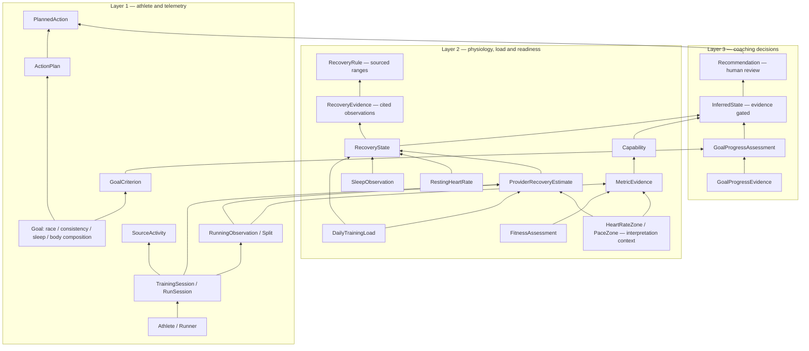

# Fitness goals ontology: three-layer architecture

This document describes the fictional, public fitness demo. It contains no personal training data. The ontology schema is in `fitness_ontology.yaml` (DuckDB) and `fitness_ontology.starrocks.yaml` (StarRocks); both use the same concepts. `ontology_bindings.yaml` audits every concept against real datasets and existing metrics. `fitness_ontology.yaml` lists evidence limits and review rules for an agent. These knowledge files are guidance, **not** an executable SWRL/OWL reasoner.

## How to read it

- `GoalReviewWorkflow` remains a workflow-only concept. Its `targets → Goal` and `uses_plan → ActionPlan` arrows describe the Agent's procedure, not materialized DOSI joins or saved workflow runs. The ordered read/check steps are in `fitness_ontology.yaml`: resolve athlete and goal version, inspect each criterion's saved progress review and evidence, review capability and recovery context, inspect the matching plan and action statuses, then propose a human-reviewed next step. The warehouse does not gain a workflow table.
- `CompromisedRecovery` is a proposed `InferredState` code connecting RestingHeartRate and SleepObservation evidence to a human-reviewed workout adjustment. The COROS personal Overnight HRV assessment maps to `daily_hrv` and its own `OvernightHRV` concept. A future evaluator may generate a new draft ActionPlan version for a scheduled key PlannedAction; it does not overwrite an approved plan. See `RECOVERY_RULES.md`.
- `InferredState` remains a rule catalog for Agent review flags. It does not add athlete-state rows, execute OWL/SWRL rules, or repeat the saved conclusions in `GoalProgressAssessment` and `RecoveryState`. The Agent must check each flag's evidence gate in `fitness_ontology.yaml`; missing evidence means no state is emitted, and disabled flags remain disabled. A review flag is not a physiological measurement or diagnosis.
- `RaceEvent` represents a verified completed road race linked to `TrainingSession`. `PostRaceRecoveryReview` relates its official course distance to an athlete-configured easy/rest window and dated `PlannedAction` records. `HardEasySequenceReview` relates consecutive planned intensities to an explicit easy run or rest action. Both lead only to a human-reviewed `Recommendation` and draft plan revision. The race filter, official course distance, structured planned intensity and rule evaluator are not yet executable mappings; see `ontology_bindings.yaml` and `fitness_ontology.yaml`.
- `Recommendation` also remains a catalog, not a saved suggestion or decision record. The Agent cites a saved review and its evidence when proposing a next step. The runner decides whether to accept it; only an approved plan or action revision is persisted in the plan model. Its `triggered_by` and `adjusts` arrows explain reasoning, not database joins or automatic provider writes.
- The current mapping audit contains 22 mapped concepts and 26 concept-to-concept joins; none of the mapped concepts is isolated. Some additional ontology arrows remain conceptual, including inverse one-to-many descriptions such as `Goal.has_criterion` and `GoalProgressAssessment.supported_by`. The queryable child-to-parent joins are `GoalCriterion.belongs_to → Goal` and `GoalProgressEvidence.supports → GoalProgressAssessment`. To list a goal's criteria, filter `goal_criterion` by `athlete_id`, `goal_id` and `goal_version`; to list an assessment's evidence, filter `goal_progress_evidence` by `athlete_id`, `assessment_id` and `assessment_version`. DOSI's validation reports the conceptual inverse arrows as unmapped; do not treat them as executable joins.
- Existing ontology concepts remain mapped to the same semantic model datasets. `Athlete`, `TrainingSession`, and `RunningObservation` correspond to Runner, RunSession, and Split in the proposed product language. A planned rest day is a `PlannedAction`, not a completed run.
- `Goal`, `GoalCriterion`, and `GoalProgressAssessment` are domain-neutral: race distance/time, run frequency, sleep trend, and body-composition outcomes have different evidence and comparison rules. `Goal` maps to versioned `athlete_goal`; `GoalCriterion` maps to `goal_criterion` through athlete ID, goal ID and goal version. `GoalProgressAssessment` maps to saved, dated, versioned `goal_progress_assessment` rows, and `GoalProgressEvidence` to their cited observations. `ActionPlan` maps to versioned `action_plan` rows, each linked to an exact goal version and athlete. The older fictional running plan was approved, then superseded; its revised plan is a draft awaiting approval. The two completed-week running reviews preserve the different targets in goal versions 1 and 2. Sleep and same-athlete official 10K reviews remain `insufficient_evidence`; a missing or noncomparable value never becomes zero. Body-composition measurements are not yet present. See `FITNESS_GOALS_DESIGN.md` for examples and limits.
- `PlannedAction` maps to `planned_action`, which connects each proposed run, rest day or sleep routine to one exact `ActionPlan` version. Completion review is stored separately from plan approval. The fictional old plan has one manually verified run and one date/sport candidate. Only the verified workout has a `fulfilled_by → TrainingSession` join; a candidate event ID remains an inspectable field without a fulfillment edge. Actions in pending plans remain proposed and unassessed. This fixture does not claim that COROS supplied a schedule-to-activity identifier.
- `Capability` is a saved, dated review of one ability type, not a new SQL metric or universal score. `MetricEvidence` rows cite the device estimate, observed run, race result or pace-zone boundary used in that review and link back to the source record. The fictional reviews are `baseline_only`, `descriptive_only` or `observed_outcome`, with no unsupported improvement claim. A faster comparable pace-zone boundary may support a running-capability trend when multiple scheme versions and observed runs exist; one snapshot cannot. Neither zone type is an input to `RecoveryState`. Sleep, load and recovery inform how to train and whether a trend is interpretable, rather than directly measuring aerobic capacity or running mechanics.
- The existing semantic model's metric names, formulas, sources, and SQL are unchanged. `PaceZone` maps to `running_pace_zone`, `Capability` to `capability_assessment`, `MetricEvidence` to `capability_evidence`, and `ProviderRecoveryEstimate` to `recovery_observation`. Their links are valid in both dialects. Fictional fixtures include pace-zone bounds; a particular imported athlete may have none. Concepts without a warehouse mapping appear in DOSI's catalogue but are **not queryable rows**. An agent can use `ontology_bindings.yaml` and `fitness_ontology.yaml` to interpret query results; plan revisions still need persistence.
- `DailyTrainingLoad` holds COROS short-term and long-term values and the source ratio. These device estimates are evidence of recent exercise stress and can be used as a proxy when reviewing exercise-related fatigue; they are not a direct measurement of all bodily fatigue. The published model does not declare fixed acute/chronic windows or compute a new ACWR. A high ratio alone does not establish overreaching or injury risk. `ProviderRecoveryEstimate` is a separate, time-stamped COROS estimate. Sleep and resting heart rate are reviewed independently; do not claim COROS includes them in its recovery formula. The mapped `RecoveryState` table saves one dated review per athlete and version, and `RecoveryEvidence` records each source observation, baseline coverage and rule reference. The three fictional reviews remain `insufficient_evidence`. User-configured thresholds, the seven-day and 42-day baselines, and evidence gates are defined in `fitness_ontology.yaml` under `x_coaching_knowledge`; `RECOVERY_RULES.md` explains them for readers. See [COROS Fitness Metrics](https://support.coros.com/hc/en-us/articles/53639656438548-Fitness-Metrics) and [Understanding the Recovery Widget](https://support.coros.com/hc/en-us/articles/15406707571732-Understanding-the-Recovery-Widget).
- `HeartRateZone → Athlete` and `PaceZone → Athlete` are realized joins using the existing athlete key. Neither zone type has an edge to the recovery concepts. `RecoveryState → DailyTrainingLoad / SleepObservation / RestingHeartRate / ProviderRecoveryEstimate` are realized joins for the saved review; `RecoveryEvidence → RecoveryState / RecoveryRule` realizes its cited rule path. Workout intensity links remain conceptual, without a join to a specific workout. The separate `ProviderRecoveryEstimate → DailyTrainingLoad / TrainingSession / RunningObservation` edges describe possible dependency context and do **not** reconstruct COROS's proprietary calculation. The rule evaluator remains outside DOSI's ontology engine.
- This ontology does not collect or require subjective fatigue, RPE or soreness reports. Current data do not support reliable cardiac drift or time in zones; those inferred-state codes remain disabled. VO2max and thresholds remain time-stamped device estimates. Recommendations are suggestions for human review and never write to COROS or change a plan automatically. A plan row's `approval_status` records the fictional human decision; it does not grant an agent approval authority.

## Example reasoning path

Question: **“Am I making progress toward my goal?”**

1. Resolve the athlete's active goal and its measurable criteria. The same person can have a race goal and a sleep goal simultaneously.
2. For each criterion, select a comparable semantic metric and period: same-distance official race time, standalone run days per week, or main sleep minutes by wake date. De-duplicate source activities and retain observation source and time.
3. Review each criterion against its own target and evidence. If a body-fat criterion has no dated body measurements, return insufficient evidence. Do not combine different goals into an unexplained universal score.
4. Separately review device load, recovery and other context before suggesting a next training step. Cite evidence and let the runner decide whether to adjust a plan.

The `fitness_ontology.yaml` file is intentionally separate from `fitness_analysis.yaml`. It can be revised as coaching knowledge improves without changing semantic metric definitions.
