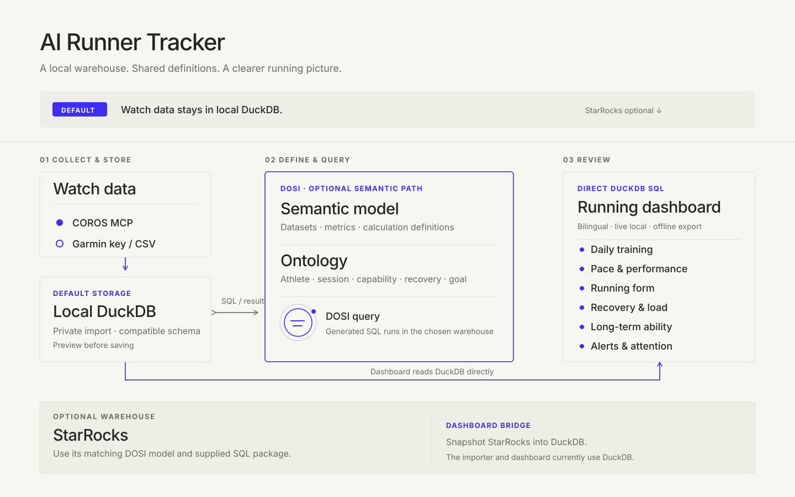

# AI Runner Tracker

**Documentation:** English (default) · [简体中文](README.zh-CN.md) · [Release notes](RELEASE_NOTES.md)

Explore running history, training load, recovery signals, and goals in a local dashboard. Start with the owner's openly shared running snapshot, use a separate fictional test case, or import your own COROS or Garmin activity data. The UI starts in English and can switch to Chinese.

You can use AI Runner Tracker simply to inspect your data. If you want to understand how consistent metric definitions and connected concepts help an Agent answer broader questions, follow the optional [DOSI semantic model and ontology tour](#explore-dosis-semantic-model-and-ontology).

## Project overview

**Local DuckDB is the default storage for running data.** The local importer writes selected watch data to a private DuckDB file; a separate fictional database powers the first-run example. The local dashboard service reads DuckDB on every refresh; the builder can also export offline HTML. StarRocks is an optional warehouse for DOSI queries, with a matching model and SQL package. The current importer writes to DuckDB, and the dashboard requires a DuckDB snapshot if its source data lives in StarRocks. Coaching rules are evaluated by the dashboard and described for an Agent or person to review; DOSI does not automatically execute them. See the [component map and storage details](ARCHITECTURE.md) or give [the user-facing Agent guide](agent.md) to an assistant helping with setup.



## Quickstart

### Start with an Agent

Give your coding Agent this prompt. It handles the local setup and shows you the existing dashboard first:

```text
Set up https://github.com/joannahe/AI-Runner-Tracker on my computer.
Read README.md and agent.md before changing anything. Use the bundled,
owner-authorized personal running data; do not connect a watch or ask me for
credentials. Create a local Python environment, install warehouse/requirements.txt,
start dashboard/action_server.py, and open http://127.0.0.1:8768/dashboard for me.
Show me the athlete selector and the Attention tab. Explain one
alert using its date, metric value, baseline or rule, and source. Keep all data
local. Do not publish or upload my data. Tell me exactly what you verified and
report any setup error rather than claiming success.
```

The Agent can fetch the repository into a local folder if it is not present. The local service reads the bundled personal DuckDB and ontology on each page refresh. It needs no StarRocks server, COROS login, or DOSI CLI. [The standalone HTML preview](dashboard/personal-preview.html) is an offline snapshot.

Open the running capability page through `/dashboard` or the generated `dashboard/personal-preview.html`. `dashboard/index.template.html` is source code for the page and does not contain usable data until the builder renders it.

### Manual alternative

Download the repository, create a Python environment, and start the local dashboard:

```sh
git clone https://github.com/joannahe/AI-Runner-Tracker.git
cd AI-Runner-Tracker
python3 -m venv .venv
.venv/bin/python -m pip install -r warehouse/requirements.txt
.venv/bin/python dashboard/action_server.py
```

Visit `http://127.0.0.1:8768/dashboard` and select **Attention / 关注点**. Each refresh reads the latest local DuckDB rows and ontology rules, then recalculates the checks in the browser. Import new watch data into the local database separately; page refresh does not contact COROS. Stop the server with Ctrl+C. The requirements install a DuckDB 1.5.6-compatible reader for the bundled snapshot and DOSI CLI. The owner dataset omits the date of birth while retaining the running metrics.

**Optional: reproduce the fictional test case.** This needs Python 3 with `venv` and `pip`. It creates a separate database with three synthetic athletes and an offline dashboard:

```sh
python3 -m venv .venv
.venv/bin/python -m pip install -r warehouse/requirements.txt
.venv/bin/python warehouse/build.py
.venv/bin/python dashboard/build.py
```

Open [dashboard/index.html](dashboard/index.html) to switch among the fictional athletes. To use your own data next, follow [Supported watches](#supported-watches) and [Add your own activity data](#add-your-own-activity-data). The fixture build script regenerates fixture SQL and the bundled model dialect files from its source, so review local model edits before running it in a customized checkout.

### Optional: try the DOSI semantic model

Install [DOSI CLI 0.2.2](https://dosi.datus.ai/install/) if you want to validate or query the semantic model. The DuckDB ontology, semantic model, and mapping are separate files under `subject/`; the optional StarRocks project has its own three-file bundle. After building the fictional database above, validate the mapping and run its fixture checks:

```sh
dosi --version
dosi validate --mapping subject/ontology/fitness.mapping.yaml
.venv/bin/python warehouse/verify_duckdb.py
```

Then try a DOSI query:

```sh
dosi query --mapping subject/ontology/fitness.mapping.yaml --metrics measured_run_distance_km --dialect duckdb
```

This prints generated SQL. To execute against the local fixture, use `--execute --db warehouse/running_demo.duckdb`. Without a filter, the metric covers all three fictional athletes; `warehouse/verify_duckdb.py` checks the expected result.

## Use another warehouse with DOSI

The semantic model and ontology sit above a queryable data source. DOSI's documented connectors include **DuckDB, SQLite, MySQL, TiDB, StarRocks, Apache Doris, PostgreSQL, Hologres, GaussDB/openGauss, Oracle, SAP HANA, ClickHouse, Trino, Snowflake, BigQuery, Databricks, and Amazon Redshift**. See the [DOSI warehouse connector guide](https://dosi.datus.ai/connectors/) for the current list, setup requirements, and connection examples.

This repository supplies ready-to-run schema, data import, and model files for **DuckDB and StarRocks only**. For another supported source, create or load the equivalent tables there, configure its DOSI connection, and adapt the SQL expressions, model dialect, and ontology bindings as its SQL behavior requires. Follow the relevant [DOSI connector documentation](https://dosi.datus.ai/connectors/) for that source. Changing the DOSI connection alone does not migrate data or retarget this project's watch importer and offline dashboard; those currently use local DuckDB.

## Supported watches

| Watch brand | Current local import method | What this version reads |
| --- | --- | --- |
| COROS | Authorize your own account through COROS MCP in the local importer; choose the read categories before import | Activities plus selected categories such as training load, sleep, resting heart rate, and overnight HRV when COROS makes them available |
| Garmin | Use your own Garmin Personal API Key for a one-time activity import, or upload a Garmin Connect Activities CSV | Activity summaries: date, sport, duration, distance, and available heart rate, cadence, power, and calories; no Garmin sleep, VO₂ max, training load, or FIT files yet |

Both paths run on your own computer and require a preview and confirmation before saving. COROS account authorization is controlled by COROS; the category choices limit what this app reads. Garmin's Personal API Key path is for the key holder's own account; multi-user Garmin account linking is not implemented. Other watch brands are not currently supported. See the [importer guide](coros_import/README.md) for setup and limits.

## Add your own activity data

1. Read [the local importer guide](coros_import/README.md), then install its additional dependencies: `.venv/bin/python -m pip install -r coros_import/requirements.txt`.
2. Start `.venv/bin/python coros_import/run_local.py` and open `http://127.0.0.1:8767/` **on the same computer**. Choose COROS or Garmin, preview the requested categories, and confirm import.
3. The imported DuckDB file stays under the ignored `coros_import/private_data/` directory. To preview it with the fictional fixture, run `.venv/bin/python dashboard/build.py --additional-db coros_import/private_data/coros_import.duckdb` and open `dashboard/index.html`. The athlete selector separates the sources.

The local importer does not run a hosted multi-user consent service or background sync. COROS uses its own authorization flow. The Garmin path accepts the holder's Personal API Key or an Activities CSV; the CSV does not contain all health metrics. The dashboard's coach messages are review aids, not medical diagnoses or automatically applied plan changes.

The private DuckDB importer records each saved category and requested date window in `fitness_demo.import_coverage`. A successful save is marked `saved_unverified`: it confirms the response was written, but does not prove that the watch service returned every activity. Mark a window `verified_complete` only after checking the provider's full page or record count, matching imported records, and confirming that no requested dates or categories failed. The weekly mileage review shows recorded totals provisionally until both compared weeks have verified activity coverage. An empty day alone is not proof that no workout occurred.

## What is in the repository

This project contains a generic DOSI semantic model and ontology with fictional fixtures for StarRocks and DuckDB. It also contains a **separate, real personal fitness dataset** supplied by the project owner for a running dashboard and a local StarRocks rebuild. The personal SQL and DuckDB files include identifying information, workout dates, and health measurements. They are not anonymized. Credentials, source connection records, raw API responses, and synchronization state are excluded.

| Data package | Included contents | Intended use |
| --- | --- | --- |
| Fictional fixture | Three synthetic athletes; DuckDB and StarRocks schema/seed SQL, goals, plans, metrics, and expected-result checks | First run and reproducible validation |
| Joanna's personal snapshot | One athlete; 22 base tables and seven analytical view results, including 82 activities, 111 running observations, 96 sleep days, 93 resting-heart-rate days, 37 daily load days, and 166 overnight HRV assessments | Realistic local dashboard and optional DOSI queries |
| Personal StarRocks rebuild | Schema, seed, verification SQL, manifest, and ZIP from the same authorized snapshot | Recreate the personal data in a separate local StarRocks database |
| Dashboard snapshots | Fictional and personal HTML dashboards; the personal HTML embeds observations | Offline browsing without a web server |
| Importer | COROS authorization and Garmin Personal API Key or CSV flow; writes to a Git-ignored private DuckDB file | Bring in a new user's own data locally |

No other user's live watch data is bundled. The personal snapshot is **not anonymized** and its SQL/HTML exports should be reviewed as personal data before mirroring or sharing this repository.

### Licenses

| Material | License |
| --- | --- |
| Project-authored source code, SQL, DOSI-compatible model and ontology YAML, generated dashboard code, and fictional fixtures | [Apache License 2.0](LICENSE) |
| Original project documentation and explanatory diagrams | [CC BY 4.0](DOCUMENTATION_LICENSE.md) |
| Owner's identifiable personal fitness observations, including embedded data in SQL, DuckDB, ZIP, and HTML exports | [CC BY-NC 4.0](DATA_LICENSE.md) |
| DOSI and other third-party products and dependencies | [Their own terms](THIRD_PARTY_NOTICES.md) |

The code is open source. The separately licensed personal dataset is available for noncommercial use with attribution; commercial use of that dataset needs separate permission. You can use the fictional fixture and importer without using the owner's data. Keep another user's imported records private unless they separately agree to publication.

## Explore DOSI's semantic model and ontology

This optional technical tour follows **warehouse tables → DOSI datasets and metrics → ontology concepts and mappings → Agent review → dashboard evidence**. The dashboard and importer also work as a running-data exploration path on their own.

1. Open [the DuckDB semantic model](fitness_analysis.yaml). Find `running_observation` and `measured_run_distance_km`; the metric aggregates measured running distance with a consistent definition. The StarRocks equivalent is [here](fitness_analysis.starrocks.yaml).
2. Open [the ontology](subject/ontology/fitness.ontology.yaml), its [DOSI mapping](subject/ontology/fitness.mapping.yaml), and the [binding audit](ontology_bindings.yaml). Follow `Athlete → TrainingSession → SourceActivity` and `RecoveryState → OvernightHRV` to see how business concepts connect to datasets and evidence. `dosi describe TrainingSession --mapping subject/ontology/fitness.mapping.yaml` inspects a mapped concept.
3. Read [the rule catalog](fitness_ontology.yaml) and [coach contract](TRAINING_COACH_AGENT.md). They define how an Agent should interpret metrics and check evidence; DOSI does **not** automatically execute these coaching rules or edit approved plans.
4. Open [the fictional dashboard](dashboard/index.html) or [the owner's local preview](dashboard/personal-preview.html). **Attention / 关注点** opens first. The owner's local DuckDB includes the approved version 3 four-week plan. Standalone HTML is an offline export; the local service reads current DuckDB data on refresh.

### Questions to try with an Agent

These everyday questions are designed to test whether an Agent can use the ontology to find relevant concepts, then check the linked metrics and review rules. Give the Agent [agent.md](agent.md) and the [full bilingual question catalog](QUESTION_CATALOG_AND_ONBOARDING.md). Select an athlete you are authorized to inspect. Ask in your own words; you do not need to name a metric or threshold.

| Ask | What a grounded answer should inspect |
| --- | --- |
| “How has my recovery been lately?” | `Athlete → RecoveryState`, with dated load, sleep, resting-heart-rate and HRV evidence; explain coverage and missing days. |
| “Am I training too hard?” | COROS daily load ratio against the effective configurable threshold (default `>1.5`), then other recovery context; call it a review flag. |
| “Which days might I need an easier workout?” | Dated recovery signals and, if present, a structured `ActionPlan → PlannedAction`; propose a draft only for athlete approval. |
| “Has my running volume risen too quickly?” | Two complete, comparable weeks of measured running distance and the configurable `>10%` review heuristic. |
| “Am I doing too many hard sessions?” | Deduplicated completed runs and COROS primary `training_focus` labels; count high-label sessions and report unknown labels, not time in heart-rate zones. |
| “Is my sleep or resting heart rate unusual for me?” | Personal sleep baselines, resting-heart-rate baseline, observation dates and the applicable rule; avoid population-wide judgments. |
| “Am I getting closer to my goal?” | The selected versioned `Goal → GoalCriterion`, matching evidence and assessment; say when a personal goal or comparable result is absent. |
| “Can I train hard after my race, and is my plan spaced well?” | Verified race distance, athlete-specific recovery policy and dated planned intensity; identify missing plan fields before claiming a conflict or a pass. |

The bundled personal snapshot has a saved half-marathon goal and a human-approved, dated training plan. It does not yet contain a computed personal `RecoveryState`. The fictional fixture has other example goals and plans. DOSI maps concepts and queries semantic metrics; the dashboard reviews dated plan spacing, while the Agent applies the remaining coaching rules to evidence. DOSI does not automatically change a plan or send reminders.

### Approve a suggested action locally

The quantitative review rules and their `recommendation_options` live in `ai_context.x_coaching_knowledge` inside [the DuckDB ontology](fitness_ontology.yaml); the StarRocks ontology carries the same catalog. Both ontology/model/mapping triples were checked against the [Apache Ossie 0.2 schemas](https://github.com/apache/ossie/tree/5ebe400b393b837b3a8c8b2f22738b5e30eb05e5/ontology), matching DOSI 0.2.2's `osi spec 0.2.0.dev0`. DOSI executes the ontology's `derived_by` filters for `HighLoadDay`, `LowLoadDay` and `CorosHighFocusRunActivity`; see the [query walkthrough](ONTOLOGY_ARCHITECTURE.md#queryable-derived-concepts). The dashboard builder reads the AI-context catalog for broader alert reviews. DOSI does not execute those multi-record coaching rules.

To enable the alert buttons, start the loopback-only action service after installing `warehouse/requirements.txt`:

```sh
.venv/bin/python dashboard/action_server.py
```

Open `http://127.0.0.1:8768/dashboard` for the live local personal dashboard or `/demo` for the fictional offline example. Expand a triggered alert and confirm one of the ontology-defined suggested actions. The service records an **approved request** in Git-ignored `dashboard/private_data/approved_actions.jsonl`; it does not silently alter an approved plan or call an Agent that is not running. Give [the Agent guide](agent.md) to a local Agent and ask it to process pending requests. The Agent must recheck the source evidence and target plan, create a versioned **draft** under `dashboard/private_data/`, then record its result with `dashboard/agent_actions.py`. The page shows “waiting” until that result exists. If there is no usable goal or scheduled action, the Agent records the missing input instead of claiming a plan change.

Each request to `/dashboard` reads the current personal DuckDB rows and `ai_context.x_coaching_knowledge` rule catalog from `fitness_ontology.yaml`. The browser recalculates checks from that fresh response. A standalone HTML file and `/demo` still use offline snapshots. The dashboard evaluates review signals in JavaScript; DOSI does not execute these coaching rules.

The personal Attention tab compares the latest two completed weeks and shows the approved detailed version 3 plan; version 1 is superseded and version 2 is a withdrawn draft. Each week shows estimated running mileage, including warm-up and cool-down. DEKA FIT doubles has a personal mileage range until the partner split is agreed. Planned segments and distance ranges are mapped into the semantic model and ontology.

### Review an Agent-proposed training plan

Give the Agent your goal, available training days and time limits, and any race dates. The Agent should query recent training through the semantic model, propose dated sessions with `low`, `moderate` or `high` planned intensity, and save its proposal as a JSON draft. A detailed draft may include bilingual session names, running-distance estimates and ordered warm-up, main-set and cool-down segments with provisional pace and heart-rate targets. The athlete reviews the draft before it becomes an approved plan. A race replaces a training session in that week; an explicit rest day is a separate action.

Use `dashboard/plan_import.py DRAFT.json --db personal_duckdb/joanna_fitness.duckdb` to validate a draft without writing it. Add `--apply` to save a pending version. After the athlete explicitly approves that exact version, run `dashboard/plan_approve.py DRAFT.json` to activate it. Neither command sends a plan to a watch. Rebuild with `dashboard/build.py --personal` to see the dated plan and hard/easy spacing review. A post-race review needs a completed race with verified course distance and an athlete recovery-window setting; planned race dates alone do not trigger it.

For an athlete-selected threshold training target, run `.venv/bin/python dashboard/set_training_pace_target.py --fast 5:30 --slow 5:55 --effective-date 2026-11-24` with your own range and date. This writes a versioned `running_pace_zone` record with `scheme_method=user_threshold_target`; it does not change COROS's threshold pace measurement. Ask the Agent to read the latest active target through DOSI, compare it with the device estimate and recent runs, and create a new pending plan version with aligned pace and heart-rate ranges. Existing approved plans stay in effect until approval.

### Use the owner's real-data snapshot locally

The owner's included HTML dashboard is ready to inspect as described in [Quickstart](#quickstart). For model-backed queries against the owner's snapshot, install DOSI and the Python dependencies, then build the compatible overlay:

```sh
.venv/bin/python warehouse/build_personal_overlay.py
dosi query --mapping subject/ontology/fitness.mapping.yaml --metrics avg_overnight_hrv_ms --group-by daily_hrv.athlete_id --execute --db warehouse/running_demo_personal.duckdb
```

Open `dashboard/personal-preview.html` for the ready-made dashboard. It embeds personal observations. Use the reader from `warehouse/requirements.txt` to rebuild against the included database; the bundled snapshot uses a DuckDB 1.5-compatible storage version. `node dashboard/rebuild_from_snapshot.mjs` remains an optional way to refresh the HTML from its bundled export.

The owner has authorized this dataset for the project. **Do not treat it as anonymized** or copy it into another user's private import. Generated HTML and SQL exports also contain the data. Other people's imports stay outside Git in `coros_import/private_data/` unless they separately consent to sharing.

English is the default language for the project and its local UIs. The COROS consent page and offline lineage preview offer an **English / 中文** switch. Model identifiers and SQL stay in English in both views so examples remain reproducible.

## Contents

- `fitness_analysis.yaml` and `fitness_ontology.yaml`: **default local DuckDB pair**. The ontology embeds the DuckDB semantic model. The model includes versioned `athlete_goal` and `action_plan`, version-scoped `planned_action` and `goal_criterion`, criterion-specific `goal_progress_assessment` with `goal_progress_evidence`, saved daily `recovery_state` with `recovery_evidence`, dated `capability_assessment` with `capability_evidence`, and the static `recovery_rule` knowledge table; existing metric formulas are unchanged.
- `subject/ontology/fitness.mapping.yaml`: the default **DuckDB** mapping, with its ontology and semantic model in `subject/`.
- `starrocks_project/subject/ontology/fitness.mapping.yaml`: optional **StarRocks** mapping in a separate project tree, with the same concepts and fixture data for a separately configured warehouse.
- `ONTOLOGY_ARCHITECTURE.md`, `ontology_bindings.yaml`, `fitness_ontology.yaml`, and `RECOVERY_RULES.md`: the three-layer concept map, a per-concept audit, and reviewable recovery rules. The rule catalog guides an agent; it is not an executable SWRL/OWL reasoner.
- `QUESTION_CATALOG_AND_ONBOARDING.md`: reusable English/Chinese athlete questions, their ontology and evidence paths, answer limits, and first-run information needed for the future open-source setup.
- `TRAINING_COACH_AGENT.md`: proposed Agent review cycle, rule-triggered reminder contract, evidence and duplicate-alert handling, human approval boundary, and work required before proactive coaching is enabled.
- `AGENTS.md`: repository instructions for coding Agents, including privacy boundaries, generated-file rules, and verification commands. `agent.md` is the separate user-facing assistant guide for setup, import, DOSI exploration, and evidence-based reviews.
- `FITNESS_GOALS_DESIGN.md`: general goal, plan, action, criterion, evidence and progress-assessment design. Fictional versioned goals, plans, proposed or approved actions, criteria and criterion-specific reviews are implemented; real provider plan import, provider ability scores and body measurements remain proposals.
- `lineage.html`: offline visual preview of the public model and ontology, with bilingual interface controls. While the local app is running, open `http://127.0.0.1:8767/lineage`.
- `dosi-ontology-view.html`: DOSI's generated ontology viewer, showing actual mapped concepts and joins.
- `dashboard/index.html`: offline running capability dashboard using fictional fixtures. `dashboard/personal-preview.html` uses the owner's historical data. The dashboard has a generic English-first interface, English/Chinese toggle, date filters, and an athlete selector at the very top. Rebuild with `python3 dashboard/build.py` or `python3 dashboard/build.py --personal`. To include a separately imported athlete, add `--additional-db coros_import/private_data/coros_import.duckdb` to the personal build command; repeat that option for further databases. The shell and chart choices have been revised against the owner's Datus export and pasted entry component; see [reconstruction notes](dashboard/RECONSTRUCTION.md) for the implemented features and remaining differences.

  The weekly mileage check counts measured run distance from standalone runs **and** hybrid run segments. To report a verified week-to-week result, provide `--coverage-file path/to/coverage.json`, a JSON object mapping dashboard athlete IDs to arrays of `YYYY-MM-DD` dates whose activity imports have been independently verified complete. For example: `{"demo_01":["2026-04-06","2026-04-07"]}`. Both compared Monday–Sunday weeks need all seven dates verified; otherwise the dashboard shows the recorded distance as incomplete evidence and does not issue a mileage verdict. Never mark an unverified day complete merely because it has a workout row.

  DOSI can also execute the default 10% weekly review as the Apache Ossie `HighMileageGrowthWeek` derived subtype. The warehouse's `v_weekly_running_distance` view computes consecutive verified weeks; its `activity_import_coverage` table must contain seven `verified_complete` dates for each compared week. The fictional seed includes two verified weeks. For an existing DuckDB or StarRocks warehouse, apply `warehouse/weekly_mileage_duckdb.sql` or `warehouse/weekly_mileage_starrocks.sql` once, then insert only independently verified import dates. The personal DuckDB copy has the view and an empty coverage table. Run `python scripts/validate_ossie.py` to check every model, ontology and mapping YAML against the pinned Ossie 0.2 schemas.
- `personal_duckdb/joanna_fitness.duckdb`: local analytical snapshot of the owner's StarRocks data, refreshed on 2026-11-17, with 22 base tables and 7 materialized view results in the `fitness_demo` schema. It includes 166 COROS overnight HRV assessments. The views are static in this file.
- `personal_starrocks/schema.sql`, `seed.sql`, `verify.sql`, `manifest.json`: a local StarRocks rebuild package for an empty `joanna_fitness` database, refreshed from the same snapshot. `personal_starrocks.zip` contains the same files. StarRocks view definitions are live views. See [personal dataset instructions](personal_starrocks/README.md).
- `warehouse/build_personal_overlay.py`: builds `warehouse/running_demo_personal.duckdb` from the fictional fixture and tracked personal snapshot. The resulting separate database is compatible with the default DuckDB DOSI model and installed DOSI engine. It retains the fictional athletes, so filter queries by athlete when analyzing one person. No calculated personal `RecoveryState` is fabricated.
- `warehouse/build.py`: single source of fictional rows; writes two matching SQL schema/seed pairs, synchronizes both standalone semantic models with their project trees, and builds a DOSI-compatible `warehouse/running_demo.duckdb` locally.
- `warehouse/starrocks_schema.sql`, `warehouse/starrocks_seed.sql`: StarRocks DDL and synthetic rows.
- `warehouse/export_personal_starrocks_seed.py`, `warehouse/starrocks_personal_seed.sql`: reproducible additive personal rows for the same `fitness_demo` StarRocks schema. Load the personal seed once after the fictional seed into a new database. It contains identifying health data. The live remote `joanna_fitness` database already contains the owner's current data; this additive seed has not been loaded into a separate local StarRocks server.
- `warehouse/duckdb_schema.sql`, `warehouse/duckdb_seed.sql`: DuckDB DDL and the same synthetic rows.
- `warehouse/verify_duckdb.py`, `warehouse/starrocks_acceptance.sql`: expected row counts and metrics.
- `coros_import/`: local COROS OAuth / MCP and Garmin Personal API Key or CSV importer; writes real data only to an ignored private DuckDB file after confirmation. See [its README](coros_import/README.md).

## Additional build and verification notes

After setting up the fictional test case, you can create an owner-inclusive overlay and export the owner's StarRocks seed with:

```sh
.venv/bin/python warehouse/build_personal_overlay.py
.venv/bin/python warehouse/export_personal_starrocks_seed.py
```

The fictional `warehouse/running_demo.duckdb` is ignored by Git and can be recreated from the fixture generator. The separate personal DuckDB snapshot is explicitly included. Run `python3 dashboard/build.py --personal` to rebuild its HTML view.

For example, after importing a watch user's data into the private DuckDB file, run `python3 dashboard/build.py --personal --additional-db coros_import/private_data/coros_import.duckdb` and open `dashboard/personal-preview.html`. The selector will include athletes from both sources. The HTML is a static snapshot: rerun the build after imports. It embeds all selected athletes' records, so keep a preview with other people's health data private unless they have agreed to share it.

For a StarRocks database, run `warehouse/starrocks_schema.sql` then `warehouse/starrocks_seed.sql` **in order** using a database user with permission to create the `fitness_demo` database and its tables/views. For the owner-inclusive variant, then load `warehouse/starrocks_personal_seed.sql` once. Run `warehouse/starrocks_acceptance.sql` to check the fictional rows and compare owner counts with `personal_starrocks/manifest.json`. These seeds are intended for a new, empty schema; running them twice duplicates rows. No StarRocks connection or credentials are included.

## DOSI commands

```sh
dosi validate --mapping subject/ontology/fitness.mapping.yaml
dosi describe TrainingSession --mapping subject/ontology/fitness.mapping.yaml
dosi query --mapping subject/ontology/fitness.mapping.yaml --metrics measured_run_distance_km --dialect duckdb
dosi validate --mapping starrocks_project/subject/ontology/fitness.mapping.yaml
dosi query --mapping starrocks_project/subject/ontology/fitness.mapping.yaml --metrics run_session_count --dialect starrocks
```

On the fictional fixtures, `measured_run_distance_km` = **41** across all athletes, `run_session_count` = **5**, canonical `coros_training_load` = **868** despite one duplicate activity record, and the fictional official 10K time = **3190 seconds**. The fictional dashboard defaults to `demo_01` (33 km over four runs). `verify_duckdb.py` executes DOSI-generated SQL against DuckDB. The fictional StarRocks DDL has not been executed against a live local StarRocks instance.

The local personal DuckDB snapshot contains 88 activities, 115 running observation rows, and 171 overnight HRV assessments through 2026-11-23, plus the approved plan. The bundled personal StarRocks package is an older export and does not include this local plan; it has **not** been loaded into a separate local StarRocks server. Review personal files before publishing this repository; base64 encoding inside the SQL is not a privacy measure.

The default `fitness_analysis*.yaml` models target the `fitness_demo` fixture schema and include fictional goal/rule tables. `warehouse/running_demo_personal.duckdb` adds the owner's mapped source records to that schema and can be queried with the default DuckDB mapping. For example: `dosi query --mapping subject/ontology/fitness.mapping.yaml --metrics avg_overnight_hrv_ms --group-by daily_hrv.athlete_id --execute --db warehouse/running_demo_personal.duckdb`. The personal StarRocks rebuild uses the original `joanna_fitness` database and does not add those fictional tables; using DOSI against it requires a matching personal model, not a simple database-name substitution.

The local [COROS and Garmin importer](coros_import/README.md) writes consented watch data into a separate private DuckDB with the same `fitness_demo` schema. It never adds personal records to public fixtures.
