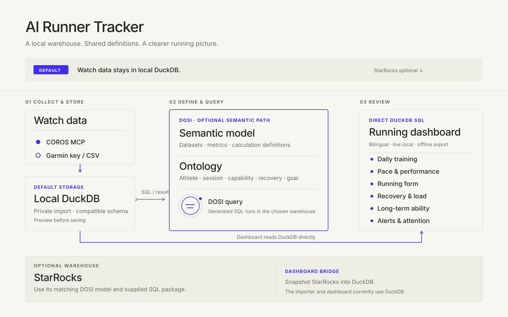

# AI Runner Tracker

**文档语言：** [English（默认）](README.md) · 简体中文 · [更新说明](RELEASE_NOTES.md)

在本地看板中查看跑步历史、训练负荷、恢复信号和目标。你可以先体验项目作者公开提供的真实跑步数据，使用独立的虚构测试数据，或导入自己的 COROS / Garmin 运动记录。界面默认显示英文，可切换为中文。

只想分析跑步数据也可以直接使用。如果想了解统一的指标定义和本体概念如何帮助 Agent 回答更广泛的问题，可以阅读下方的 [DOSI 语义模型与本体导览](#探索-dosi-语义模型与本体)。

## 项目概览

**本地 DuckDB 是默认数据存储。** 导入工具将用户选择的手表数据写入私有 DuckDB 文件；另有一套独立的虚构数据用于首次体验。本地看板服务每次刷新读取 DuckDB，也可以导出离线 HTML。StarRocks 是 DOSI 查询的可选数据仓库，仓库内提供对应的模型和 SQL 包。当前手表导入工具仍写入 DuckDB；如果数据在 StarRocks，看板需要其 DuckDB 快照。看板会依据本体规则计算检查点，DOSI 本身不会自动执行教练规则。另见 [组件与存储架构](ARCHITECTURE.md) 和供助手使用的 [Agent 操作指南](agent.md)。



## 快速开始

### 让 Agent 帮你启动

把下面的提示词交给你的编程 Agent。它会在本机完成准备工作，先打开已有的看板：

```text
请在我的电脑上安装并运行 https://github.com/joannahe/AI-Runner-Tracker 。
先阅读 README.md 和 agent.md，再进行任何修改。先使用仓库中由作者授权公开的
个人跑步样例数据；不要连接手表，也不要向我索取登录凭据。请创建本地 Python
环境，安装 warehouse/requirements.txt，启动 dashboard/action_server.py，
为我打开 http://127.0.0.1:8768/dashboard。展示看板顶部的运动员选择器和
关注点标签页，选一条提示解释它的日期、指标数值、基线或规则及数据来源。
所有数据留在本地，不要发布或上传我的数据。最后说明你实际验证了哪些步骤；
如果遇到安装错误，请如实报告，不要声称已经成功。
```

如果本地还没有项目，Agent 可以自行获取仓库。首次展示由本地服务在每次刷新时读取个人 DuckDB 和本体规则；不需要 StarRocks 服务、COROS 登录或 DOSI 命令行。[单独的 HTML 预览](dashboard/personal-preview.html)是离线快照。

请通过 `/dashboard` 或生成好的 `dashboard/personal-preview.html` 打开跑步能力页面。`dashboard/index.template.html` 是页面模板，尚未注入数据，不能直接打开使用。

### 手动启动（备选）

下载仓库、创建 Python 环境并启动本地看板：

```sh
git clone https://github.com/joannahe/AI-Runner-Tracker.git
cd AI-Runner-Tracker
python3 -m venv .venv
.venv/bin/python -m pip install -r warehouse/requirements.txt
.venv/bin/python dashboard/action_server.py
```

访问 `http://127.0.0.1:8768/dashboard`，打开 **关注点**。每次刷新都会读取最新的本地 DuckDB 数据和本体规则，再由页面重新计算检查点；新增手表数据仍需先导入本地数据库，刷新页面不会直接连接 COROS。按 Ctrl+C 停止服务。依赖中指定了兼容随仓库快照和 DOSI CLI 的 DuckDB 1.5.6 系列。个人数据已移除出生日期，保留跑步指标。

**可选：复现虚构测试案例。** 需要带 `venv` 和 `pip` 的 Python 3。以下命令会创建包含三位虚构运动员的独立数据库和离线看板：

```sh
python3 -m venv .venv
.venv/bin/python -m pip install -r warehouse/requirements.txt
.venv/bin/python warehouse/build.py
.venv/bin/python dashboard/build.py
```

打开 [dashboard/index.html](dashboard/index.html) 切换虚构运动员。之后若想接入自己的数据，请阅读[支持的手表](#支持的手表)和[导入自己的运动数据](#导入自己的运动数据)。测试数据构建脚本会从源文件重新生成测试 SQL 和两套模型方言文件；若你已自行修改模型，运行前请检查这些改动。

### 可选：试用 DOSI 语义模型

如需验证或查询语义模型，请安装 [DOSI CLI 0.2.2](https://dosi.datus.ai/install/)。DuckDB 本体、语义模型和映射分别存放在 `subject/` 下；可选的 StarRocks 版本位于独立项目目录。构建上述虚构数据库后：

```sh
dosi --version
dosi validate --mapping subject/ontology/fitness.mapping.yaml
.venv/bin/python warehouse/verify_duckdb.py
```

生成一条 DOSI 查询：

```sh
dosi query --mapping subject/ontology/fitness.mapping.yaml --metrics measured_run_distance_km --dialect duckdb
```

该命令会打印生成的 SQL。若要在本地测试库执行，追加 `--execute --db warehouse/running_demo.duckdb`。不加筛选时，指标覆盖三位虚构运动员；`warehouse/verify_duckdb.py` 会核对预期结果。

## 将其他数据仓库接入 DOSI

语义模型和本体建立在可查询的数据源之上。DOSI 文档列出的连接器包括 **DuckDB、SQLite、MySQL、TiDB、StarRocks、Apache Doris、PostgreSQL、Hologres、GaussDB/openGauss、Oracle、SAP HANA、ClickHouse、Trino、Snowflake、BigQuery、Databricks 和 Amazon Redshift**。最新支持列表、配置要求与连接示例请查阅 [DOSI 数据仓库连接器文档](https://dosi.datus.ai/connectors/)。

本仓库只为 **DuckDB 和 StarRocks** 准备了可直接使用的表结构、导入脚本和模型文件。如需使用其他受支持的数据源，请在目标数据源中建立或加载等价的表，配置 DOSI 连接，并按该数据库的 SQL 行为调整表达式、模型方言与本体绑定。只更改 DOSI 连接不会自动迁移数据，也不会让当前仍使用 DuckDB 的手表导入工具与离线看板切换存储。

## 支持的手表

| 品牌 | 当前本地导入方式 | 本版本读取的数据 |
| --- | --- | --- |
| COROS | 在本地导入器中授权自己的账号，通过 COROS MCP 连接；导入前选择读取类别 | 运动记录，以及 COROS 提供且用户选择的训练负荷、睡眠、静息心率、夜间 HRV 等类别 |
| Garmin | 使用自己的 Garmin Personal API Key 单次导入，或上传 Garmin Connect Activities CSV | 日期、运动类型、时长、距离，以及可用的心率、步频、功率、热量等活动摘要；目前不导入 Garmin 睡眠、VO₂ max、训练负荷或 FIT 文件 |

两条路径都在本机运行，保存前会显示预览并要求确认。COROS 账号授权由 COROS 控制；类别选择限制本应用实际读取的内容。Garmin Personal API Key 仅用于密钥持有人的账号；尚未实现面向多用户的 Garmin 账号连接。其他手表品牌暂未支持。设置与限制详见[导入器说明](coros_import/README.md)。

## 导入自己的运动数据

1. 阅读[本地导入器说明](coros_import/README.md)，安装额外依赖：`.venv/bin/python -m pip install -r coros_import/requirements.txt`。
2. 运行 `.venv/bin/python coros_import/run_local.py`，在**同一台电脑**打开 `http://127.0.0.1:8767/`。选择 COROS 或 Garmin，预览所请求的数据类别并确认导入。
3. 数据写入被 Git 忽略的 `coros_import/private_data/` 下的 DuckDB 文件。若要与虚构数据一起预览，运行 `.venv/bin/python dashboard/build.py --additional-db coros_import/private_data/coros_import.duckdb`，然后打开 `dashboard/index.html`。顶部运动员选择器会区分数据来源。

导入器不是托管的多用户授权服务，也不会在后台同步。COROS 使用其自己的授权流程。Garmin 路径接受密钥持有人的 Personal API Key 或 Activities CSV；CSV 不含全部健康指标。看板上的教练提示仅供复核，不能视为医疗诊断，也不会自动修改训练计划。

## 仓库包含什么

项目包含通用 DOSI 语义模型与本体，以及 DuckDB 和 StarRocks 的虚构测试数据。此外还包含**一套单独的真实个人运动数据**，由项目作者提供，用于跑步看板及在本地重建 StarRocks 数据。个人 SQL 与 DuckDB 文件含可识别信息、运动日期和健康测量值，**没有匿名化**。仓库不包含密钥、数据源连接记录、原始 API 响应或同步状态。

| 数据包 | 内容 | 用途 |
| --- | --- | --- |
| 虚构测试数据 | 三位虚构运动员；DuckDB / StarRocks 表结构和种子 SQL、目标、计划、指标及验收结果 | 首次运行与可复现验证 |
| Joanna 的个人快照 | 一位运动员；22 张基础表和 7 份分析视图结果，含 88 条活动、115 条跑步观察及 171 条夜间 HRV 评估；本地 DuckDB 另有已批准的半马目标与训练计划 | 真实本地看板与可选 DOSI 查询 |
| 个人 StarRocks 重建包 | 基于同一授权快照的表结构、种子数据、核验 SQL、清单和 ZIP | 在单独的本地 StarRocks 库中重建个人数据 |
| 看板快照 | 虚构与个人 HTML 看板；个人 HTML 内嵌观察数据 | 无需服务器即可浏览 |
| 导入器 | COROS 授权及 Garmin Personal API Key / CSV 流程；写入被 Git 忽略的私有 DuckDB | 在本地导入新用户自己的数据 |

仓库不包含其他人的实时手表数据。个人快照**没有匿名化**；镜像或再次分享本仓库前，请把 SQL、HTML 导出视为个人数据进行检查。

### 许可协议

| 内容 | 许可协议 |
| --- | --- |
| 项目原创代码、SQL、兼容 DOSI 的模型与本体 YAML、看板生成代码及虚构测试数据 | [Apache License 2.0](LICENSE) |
| 原创项目文档与说明性图表 | [CC BY 4.0](DOCUMENTATION_LICENSE.md) |
| 作者可识别的个人运动观察数据，包括 SQL、DuckDB、ZIP 与 HTML 导出中内嵌的数据 | [CC BY-NC 4.0](DATA_LICENSE.md) |
| DOSI 及其他第三方产品与依赖 | [各自的条款](THIRD_PARTY_NOTICES.md) |

项目代码开源；单独授权的个人数据允许署名、非商业使用，商业使用需另行取得许可。你可以仅使用虚构测试数据和导入器。未经其他用户单独同意，请不要公开他们导入的数据。

## 探索 DOSI 语义模型与本体

这是一条可选的技术导览：**仓库表 → DOSI 数据集和指标 → 本体概念与映射 → Agent 复核 → 看板证据**。如果只想分析跑步数据，也可以直接使用导入器和看板。

1. 打开 [DuckDB 语义模型](fitness_analysis.yaml)，查看 `running_observation` 与 `measured_run_distance_km`：后者按一致口径汇总实测跑量。[StarRocks 对应模型](fitness_analysis.starrocks.yaml)也在仓库中。
2. 打开[本体](subject/ontology/fitness.ontology.yaml)、[DOSI 映射文件](subject/ontology/fitness.mapping.yaml)及[映射核查表](ontology_bindings.yaml)，沿 `Athlete → TrainingSession → SourceActivity` 和 `RecoveryState → OvernightHRV` 查看概念如何关联数据集与证据。`dosi describe TrainingSession --mapping subject/ontology/fitness.mapping.yaml` 可检查一个已映射概念。
3. 阅读[规则目录](fitness_ontology.yaml)和[教练工作约定](TRAINING_COACH_AGENT.md)。它们指导 Agent 如何解释指标和检查证据；DOSI **不会**自动执行这些教练规则或修改已批准的计划。
4. 打开[虚构数据看板](dashboard/index.html)或[作者个人预览](dashboard/personal-preview.html)。「关注点」会默认打开。作者个人 DuckDB 中已生效的是第 3 版详细训练计划；第 1 版保留为旧版，第 2 版已撤回。单独的 HTML 是离线导出；本地服务每次刷新都会重新读取 DuckDB。

### 可以交给 Agent 测试的问题

这些日常提问用于检验 Agent 能否沿本体找到相关概念，再核对关联指标和复核规则。向 Agent 提供 [agent.md](agent.md) 与[完整的中英文问题目录](QUESTION_CATALOG_AND_ONBOARDING.md)，并选择你有权查看的运动员。你可以用自己的话提问，不必先知道指标名或阈值。

| 可以这样问 | 有依据的回答应检查什么 |
| --- | --- |
| “我最近恢复得怎么样？” | `Athlete → RecoveryState`，以及带日期的负荷、睡眠、静息心率和 HRV 证据；说明覆盖情况和缺失日期。 |
| “我最近是不是练得太狠了？” | COROS 每日负荷比与生效的可配置阈值（默认 `>1.5`），并查看其他恢复背景；将结果称为需复核的信号。 |
| “哪天我应该练轻松一点？” | 当日恢复信号；如有结构化计划，再检查 `ActionPlan → PlannedAction`，仅提出供运动员批准的修改草案。 |
| “我最近跑量涨得太快了吗？” | 两个完整、可比周的实测跑量，以及可配置的 `>10%` 增幅复核规则。 |
| “我的高强度跑是不是太多了？” | 去重后的已完成跑步和 COROS 的主要 `training_focus` 标签；统计高强度标签的训练次数并说明未知标签，不能说成心率区间停留时长。 |
| “最近睡眠或静息心率和我平时相比正常吗？” | 个人睡眠及静息心率基线、观察日期和适用规则，不套用未经选择的人群标准。 |
| “我离目标更近了吗？” | 当前版本的 `Goal → GoalCriterion`、对应证据和评估；个人目标或可比成绩缺失时明确说明。 |
| “比赛后能练强度吗？训练安排合理吗？” | 经核实的赛程距离、运动员自己的赛后恢复设置，以及按日期记录的计划强度；计划字段不足时不能断言有冲突或已经安全。 |

当前本地个人 DuckDB 已保存目标、按日期的训练计划及批准状态；尚无已计算的个人 `RecoveryState`。虚构测试库也有示例目标和计划。DOSI 负责概念映射和语义指标查询；Agent 需要依据证据应用本体中的复核规则，不能声称 DOSI 会自动执行教练规则、修改计划或发送提醒。

### 在本地确认建议行动

量化规则及其 `recommendation_options` 统一写在 [DuckDB 本体](fitness_ontology.yaml)的 `ai_context.x_coaching_knowledge` 中；StarRocks 本体包含相同目录。两套本体／模型／映射文件均已按与 DOSI 0.2.2 的 `osi spec 0.2.0.dev0` 对应的 [Apache Ossie 0.2 schema](https://github.com/apache/ossie/tree/5ebe400b393b837b3a8c8b2f22738b5e30eb05e5/ontology) 校验。DOSI 会执行 `HighLoadDay`、`LowLoadDay` 和 `CorosHighFocusRunActivity` 的本体 `derived_by` 筛选；详见[查询步骤](ONTOLOGY_ARCHITECTURE.md#queryable-derived-concepts)。看板从 AI 上下文读取更广泛的告警复核规则；DOSI 不会自动执行这些跨记录教练规则。

安装 `warehouse/requirements.txt` 后，启动仅监听本机的行动服务，才可使用告警按钮：

```sh
.venv/bin/python dashboard/action_server.py
```

打开 `http://127.0.0.1:8768/dashboard` 查看实时读取本地数据的个人看板，或打开 `/demo` 查看虚构数据的离线示例。展开触发的告警，确认一项本体中定义的建议行动。服务会把**已批准的请求**写入 Git 忽略的 `dashboard/private_data/approved_actions.jsonl`；它不会私自修改已批准的计划，也不会调用尚未运行的 Agent。将 [Agent 指南](agent.md)交给本地 Agent，请它处理待办请求。Agent 须重新核对数据与目标计划，在 `dashboard/private_data/` 中创建带版本的**草案**，再通过 `dashboard/agent_actions.py` 回写结果。页面在此之前显示“等待中”。如缺少目标或具体训练安排，Agent 应记录缺失项，不得声称已修改计划。

每次打开或刷新本地服务的 `/dashboard` 页面，服务都会重新读取个人 DuckDB 和 `fitness_ontology.yaml` 中的 `ai_context.x_coaching_knowledge` 规则目录，再由页面重新计算关注点。单独打开 HTML 文件或 `/demo` 时仍使用离线快照。看板用 JavaScript 计算复核信号；DOSI 本身不会执行这些教练规则。

个人数据的“关注点”页可按周查看已生效的第 3 版详细计划：每次训练含热身、主训练、放松，以及估算跑量、配速和心率；周跑量含热身与放松。DEKA FIT 双人赛在分工确认前显示个人跑量范围。告警依据第 3 版计划检查训练强度间隔、赛后安排及恢复信号。第 3 版将阈值训练目标更新为 5:30–5:55/公里、155–165 bpm；这是一条个人训练目标，不会覆盖 COROS 给出的阈值配速估计。

以后调整这类目标范围，可执行 `.venv/bin/python dashboard/set_training_pace_target.py --fast 5:30 --slow 5:55 --effective-date 2026-11-24`，将速度和生效日期换成自己的数据。脚本会把新的个人目标作为有版本的 `running_pace_zone` 记录保存。然后请 Agent 查询当前目标、设备估计和近期跑步记录，生成新的待确认训练计划版本；已批准计划不会自动更改。

### 在本地使用作者的真实数据快照

随仓库提供的个人 HTML 看板可直接按[快速开始](#快速开始)查看。若要对个人快照进行基于模型的查询，请安装 DOSI 和 Python 依赖，并构建兼容的叠加数据库：

```sh
.venv/bin/python warehouse/build_personal_overlay.py
dosi query --mapping subject/ontology/fitness.mapping.yaml --metrics avg_overnight_hrv_ms --group-by daily_hrv.athlete_id --execute --db warehouse/running_demo_personal.duckdb
```

打开 `dashboard/personal-preview.html` 查看现成看板。它内嵌个人观察数据。重新生成时使用 `warehouse/requirements.txt` 指定的读取器；随仓库的快照采用兼容 DuckDB 1.5 的存储格式。`node dashboard/rebuild_from_snapshot.mjs` 仍可从随仓库的导出数据刷新 HTML。

作者已授权此数据用于项目。**不要将其当作匿名数据**，也不要把它复制到其他用户的私有导入库。生成的 HTML 和 SQL 导出同样含有数据；未经单独同意，其他人的导入记录应始终留在 Git 之外的 `coros_import/private_data/`。

项目及本地 UI 默认英文。COROS 授权页与离线血缘预览支持 **English / 中文** 切换；两种界面下模型标识符和 SQL 仍保留英文，以确保示例可复现。

## 主要文件

- `fitness_analysis.yaml` 与 `fitness_ontology.yaml`：默认的 **DuckDB 模型与本体**。本体内嵌 DuckDB 语义模型，包含带版本的 `athlete_goal`、`action_plan`，与版本关联的 `planned_action`、`goal_criterion`，逐条件的 `goal_progress_assessment` / `goal_progress_evidence`，每日 `recovery_state` / `recovery_evidence`，按日期的 `capability_assessment` / `capability_evidence`，以及静态 `recovery_rule` 知识表。已有指标公式未改动。
- `subject/ontology/fitness.mapping.yaml`：默认 **DuckDB** 映射；其本体和语义模型分别在 `subject/` 对应目录。
- `starrocks_project/subject/ontology/fitness.mapping.yaml`：独立项目目录中的可选 **StarRocks** 映射，使用相同概念和虚构测试数据。
- `ONTOLOGY_ARCHITECTURE.md`、`ontology_bindings.yaml`、`fitness_ontology.yaml`、`RECOVERY_RULES.md`：三层概念图、逐概念映射审查及恢复规则。规则目录用于指导 Agent，并非可执行的 SWRL / OWL 推理器。
- `QUESTION_CATALOG_AND_ONBOARDING.md`：中英文通用问题、对应的本体与证据路径、回答边界，以及首次使用所需的信息。
- `TRAINING_COACH_AGENT.md`：拟议的 Agent 定期复核流程、规则触发提醒的约定、证据与重复提醒处理、人工批准边界，以及启用主动教练前仍需完成的工作。
- `AGENTS.md`：供编程 Agent 遵循的仓库约定，包括隐私边界、生成文件和验证命令；`agent.md` 则面向协助用户安装、导入和分析数据的助手。
- `FITNESS_GOALS_DESIGN.md`：通用目标、计划、安排、条件、证据及进度评估设计。虚构的带版本目标、计划、拟议或批准的安排、条件和逐条件复核已实现；设备计划导入、设备能力分数和身体测量值仍为提案。
- `lineage.html`：带中英文切换的公共模型与本体离线预览。本地导入器运行时可访问 `http://127.0.0.1:8767/lineage`。
- `dosi-ontology-view.html`：DOSI 生成的本体查看器，可查看实际映射的概念与连接。
- `dashboard/index.html`：虚构数据的离线跑步能力看板；`dashboard/personal-preview.html` 使用作者历史数据。看板有默认英文的通用界面、中英文切换、日期筛选和顶部运动员选择器。运行 `python3 dashboard/build.py` 或追加 `--personal` 可重新生成；若要加入其他用户的私有导入数据，给个人构建命令追加 `--additional-db coros_import/private_data/coros_import.duckdb`，多个数据库可重复该参数。界面与图表选择参考了作者的 Datus 导出和入口组件；已实现部分及差异见[复刻说明](dashboard/RECONSTRUCTION.md)。
- `personal_duckdb/joanna_fitness.duckdb`：截至 2026-11-23 的作者运动数据本地分析快照，位于 `fitness_demo` schema，含 22 张基础表和 7 份物化视图结果，包含 171 条 COROS 夜间 HRV 评估；本地另存已批准的个人训练计划。此文件中的视图结果是静态的。
- `personal_starrocks/schema.sql`、`seed.sql`、`verify.sql`、`manifest.json`：从同一快照生成的 StarRocks 本地重建包，目标是空的 `joanna_fitness` 数据库；`personal_starrocks.zip` 包含相同文件。StarRocks 版本使用实时视图。详见[个人数据说明](personal_starrocks/README.md)。
- `warehouse/build_personal_overlay.py`：合并虚构数据与受追踪的个人快照，生成与默认 DuckDB DOSI 模型和当前 DOSI 引擎兼容的 `warehouse/running_demo_personal.duckdb`。其中仍有虚构运动员，分析单人数据时应按运动员筛选；不会伪造个人 `RecoveryState` 计算结果。
- `warehouse/build.py`：虚构行数据的唯一来源；生成两套匹配的 SQL 表结构和种子文件，同步独立语义模型到项目目录，并在本地建立 DOSI 可读取的 `warehouse/running_demo.duckdb`。
- `warehouse/starrocks_schema.sql` 与 `warehouse/starrocks_seed.sql`：StarRocks DDL 和虚构行。
- `warehouse/export_personal_starrocks_seed.py` 与 `warehouse/starrocks_personal_seed.sql`：可复现地导出附加的个人行，写入同一 `fitness_demo` StarRocks schema。应在全新数据库中、虚构种子数据之后仅加载一次。文件含可识别的健康数据；这些附加数据尚未导入单独的本地 StarRocks 服务。
- `warehouse/duckdb_schema.sql` 与 `warehouse/duckdb_seed.sql`：DuckDB DDL 和相同的虚构数据。
- `warehouse/verify_duckdb.py` 与 `warehouse/starrocks_acceptance.sql`：预期行数和指标验收。
- `coros_import/`：本地 COROS OAuth / MCP 及 Garmin Personal API Key / CSV 导入器，确认后才把真实数据写入被 Git 忽略的私有 DuckDB。详见其 [README](coros_import/README.md)。

## 构建与验证补充说明

准备好虚构案例后，可创建含作者数据的叠加数据库并导出个人 StarRocks 种子：

```sh
.venv/bin/python warehouse/build_personal_overlay.py
.venv/bin/python warehouse/export_personal_starrocks_seed.py
```

虚构数据文件 `warehouse/running_demo.duckdb` 被 Git 忽略，可用构建脚本重新创建。单独的个人 DuckDB 快照则明确纳入仓库。运行 `python3 dashboard/build.py --personal` 可重建个人 HTML。

例如，将自己的手表数据导入私有 DuckDB 后，运行 `python3 dashboard/build.py --personal --additional-db coros_import/private_data/coros_import.duckdb` 并打开 `dashboard/personal-preview.html`，即可用选择器切换两种来源的运动员。HTML 是静态快照：每次导入后需重新生成。它会内嵌所有选中运动员的记录；未经对方同意，不要分享包含其他人健康数据的预览文件。

对于 StarRocks，使用有权创建 `fitness_demo` 数据库及其表和视图的用户，**按顺序**执行 `warehouse/starrocks_schema.sql` 和 `warehouse/starrocks_seed.sql`。如需加入作者数据，再仅执行一次 `warehouse/starrocks_personal_seed.sql`。运行 `warehouse/starrocks_acceptance.sql` 检查虚构数据，并与 `personal_starrocks/manifest.json` 比对个人行数。种子脚本用于全新的空 schema；重复执行会产生重复行。仓库不包含 StarRocks 连接信息或凭据。

## DOSI 命令

```sh
dosi validate --mapping subject/ontology/fitness.mapping.yaml
dosi describe TrainingSession --mapping subject/ontology/fitness.mapping.yaml
dosi query --mapping subject/ontology/fitness.mapping.yaml --metrics measured_run_distance_km --dialect duckdb
dosi validate --mapping starrocks_project/subject/ontology/fitness.mapping.yaml
dosi query --mapping starrocks_project/subject/ontology/fitness.mapping.yaml --metrics run_session_count --dialect starrocks
```

在虚构数据上，所有运动员的 `measured_run_distance_km` 合计为 **41**，`run_session_count` 为 **5**，去除一条重复活动记录后的标准 `coros_training_load` 为 **868**，虚构的正式 10K 成绩为 **3190 秒**。虚构看板默认显示 `demo_01`（四次跑步共 33 公里）。`verify_duckdb.py` 会在 DuckDB 中执行 DOSI 生成的 SQL。虚构 StarRocks DDL 尚未在实时的本地 StarRocks 实例中执行。

更新后的本地个人快照包含 88 条活动、115 条跑步观察，以及截至 2026-11-23 的 171 条夜间 HRV 评估。随仓库提供的个人 StarRocks 重建包生成时间较早，不含此后同步的运动记录及本地训练计划；使用前应重新导出并核对。再次发布个人文件前请检查内容；SQL 中的 Base64 编码**不是**隐私保护措施。

默认的 `fitness_analysis*.yaml` 模型面向 `fitness_demo` 测试 schema，包含虚构目标和规则表。`warehouse/running_demo_personal.duckdb` 会把作者已映射的源记录加入该 schema，可供默认 DuckDB 映射查询。例如：`dosi query --mapping subject/ontology/fitness.mapping.yaml --metrics avg_overnight_hrv_ms --group-by daily_hrv.athlete_id --execute --db warehouse/running_demo_personal.duckdb`。个人 StarRocks 重建包使用原始 `joanna_fitness` 数据库，并不包含这些虚构表；若用 DOSI 查询它，需要匹配的个人模型，不能只替换数据库名。

本地 [COROS / Garmin 导入器](coros_import/README.md)会把用户同意导入的数据写入单独的私有 DuckDB，使用相同的 `fitness_demo` schema；不会把个人记录加入公开的虚构测试数据。
# 周跑量核验

周跑量包含独立跑及混合训练中有实测距离的跑段，不把 HYROX 规则参考距离当作实测。看板只有在连续两个完整自然周的运动导入日期均经过核验后才给出增幅判断。可用 `python3 dashboard/build.py --personal --coverage-file path/to/coverage.json` 提供 JSON 文件：键是看板中的运动员 ID，值是已经独立核验完整导入的 `YYYY-MM-DD` 日期数组。没有覆盖证据时只显示已记录距离和“数据不足”，不生成减量判断；有训练记录不代表当天数据已完整导入。

DOSI 还可查询 Apache Ossie 标准 `derived_by` 定义的 `HighMileageGrowthWeek`，执行默认超过 10% 的周跑量复核。底层 `v_weekly_running_distance` 视图计算连续完整周；两个周的每一天都要在 `activity_import_coverage` 中标记为 `verified_complete` 才会返回。虚构示例已提供两周核验数据，个人 DuckDB 的覆盖表默认留空。运行 `python scripts/validate_ossie.py` 可校验所有本体、映射及语义模型 YAML。
